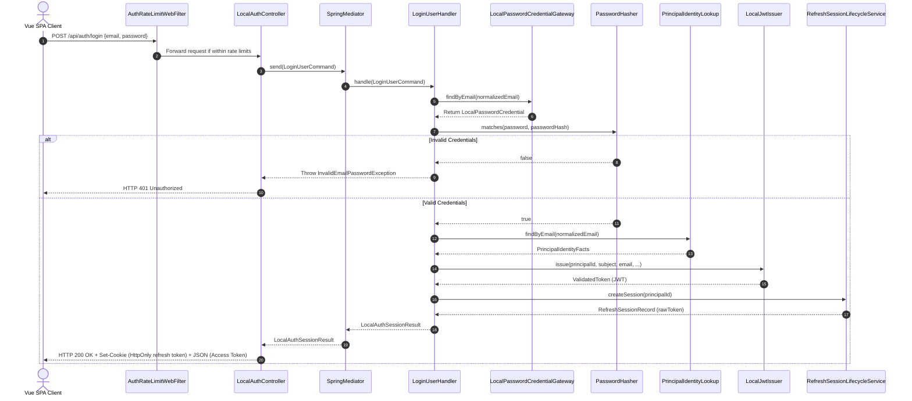
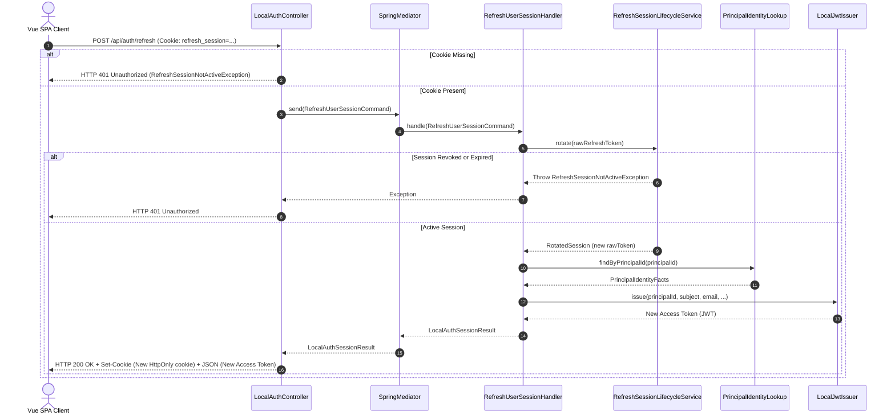
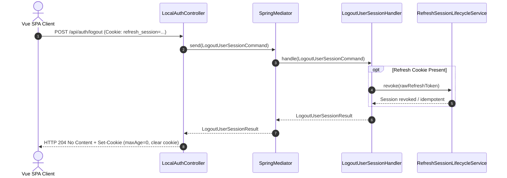
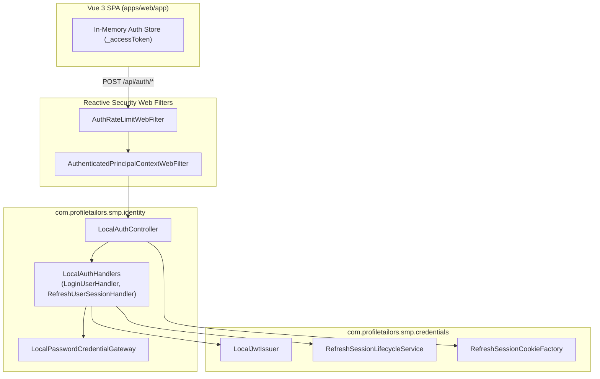

# Login Flow Architecture & Sequence Diagrams

- **Last Updated**: 2026-11-15
- **Status**: Migration in progress; local-auth flows below are pre-cutover references
- **Bounded Contexts**: `com.profiletailors.smp.identity`, `com.profiletailors.smp.credentials`
- **Related Decisions**: [ADR-0035: Keycloak BFF](adr/0035-keycloak-human-authentication-bff.md), [ADR-0009: JWT & HttpOnly Cookie Authentication](adr/0009-jwt-and-httponly-cookie-authentication.md) (superseded for human authentication), [IAM Platform](iam-platform.md)

---

## Overview

Human browser authentication is migrating to Keycloak through Spring Security `oauth2Login` and a backend-for-frontend (BFF), as defined by [ADR-0035](adr/0035-keycloak-human-authentication-bff.md). The dashboard and platform-admin SPA use separate OIDC clients, `pt-app` and `pt-admin`. Spring validates the OIDC response, resolves the existing local principal through the validated `(issuer, subject)` association, and establishes a relying-party session. Provider tokens remain server-side.

The implementation is present, but production readiness is not implied. Keycloak realm/client configuration, OTP behavior, DNS/TLS/proxy callbacks, and deployed cookie/session/CSRF/logout behavior remain operational cutover gates. Until the approved hard cutover, legacy local authentication and non-MCP machine credentials remain available; this document does not authorize their retirement.

The detailed local login, refresh, and logout flows below are retained as **pre-cutover legacy references**. They describe `/api/auth/login`, `/api/auth/refresh`, and `/api/auth/logout`, not the post-cutover human sign-in flow.

Visual companions: [legacy login sequence](./diagrams/login-sequence.html), [legacy login decisions](./diagrams/login-decisiones.html), [legacy refresh, rotation and hydrate](./diagrams/login-refresh.html).

---

## 1. Browser BFF Login Flow

The dashboard initiates `/oauth2/authorization/pt-app`; the admin SPA initiates `/oauth2/authorization/pt-admin`. The login success handler returns the browser to the safe, client-specific path captured at OIDC initiation. A BFF session is then used for browser requests; unsafe requests obtain a CSRF token from `GET /api/auth/csrf` and send it in `X-CSRF-TOKEN`.

For admin access, the BFF requires validated `pt-admin` authentication with `acr=2`; Profile Tailors still evaluates local platform permissions. A dashboard `pt-app` session alone does not authorize admin requests. The BFF session does not replace MCP credentials or workspace-scoped OAuth.

The configured callbacks and session limits are decisions in ADR-0035. Their deployed routing, Keycloak MFA behavior, and cookie attributes must pass the readiness gates before hard cutover.

## 2. Legacy Local Login Flow (Pre-Cutover Only) (`POST /api/auth/login`)

When a user submits credentials via the Vue SPA dashboard:

1. `AuthRateLimitWebFilter` checks rate limits on `/api/auth/login`.
2. `LocalAuthController` receives `LoginUserRequest` and dispatches `LoginUserCommand` via `Mediator`.
3. `LoginUserHandler` normalizes input email and verifies the password hash via `LocalPasswordCredentialGateway` and `PasswordHasher`.
4. Upon successful verification, `LoginUserHandler` looks up principal identity details (`PrincipalIdentityLookup`).
5. `LocalJwtIssuer` issues a short-lived access JWT token.
6. `RefreshSessionLifecycleService` creates a persisted refresh session and generates a raw refresh token.
7. `LocalAuthController` builds the HTTP response containing the `AuthTokens` JSON body (access token, principal ID, email, emailStatus) and sets the `HttpOnly` refresh cookie via `RefreshSessionCookieFactory`.

### Sequence Diagram: User Login

---

## 3. Legacy Local Silent Refresh Flow (Pre-Cutover Only) (`POST /api/auth/refresh`)

When the access token in memory expires or on initial SPA load with an active session:

1. SPA issues `POST /api/auth/refresh` carrying the `HttpOnly` refresh cookie automatically attached by the browser.
2. `LocalAuthController` extracts the cookie value. If missing, it throws `RefreshSessionNotActiveException`.
3. `RefreshUserSessionHandler` calls `RefreshSessionLifecycleService.rotate(rawRefreshToken)` to atomically invalidate the old refresh token and issue a new rotated session token.
4. `PrincipalIdentityLookup` resolves updated principal identity facts.
5. `LocalJwtIssuer` generates a fresh JWT access token.
6. `LocalAuthController` sets the rotated refresh cookie in the `Set-Cookie` header and returns the updated `AuthTokens` payload.

### Sequence Diagram: Token Refresh & Session Rotation

---

## 4. Legacy Local Logout Flow (Pre-Cutover Only) (`POST /api/auth/logout`)

When a user initiates explicit logout:

1. SPA calls `POST /api/auth/logout`.
2. `LocalAuthController` extracts the refresh cookie if present and sends `LogoutUserSessionCommand`.
3. `LogoutUserSessionHandler` revokes the refresh session in `RefreshSessionLifecycleService`. If the session was already inactive, revocation behaves idempotently.
4. `LocalAuthController` builds a `204 No Content` response with a cleared cookie (`maxAge = 0`).

### Sequence Diagram: User Logout

---

## 5. Legacy Local-Auth Boundaries (Pre-Cutover Only)

### Legacy Local-Auth Security Properties (Pre-Cutover Only)

These properties describe the legacy local-auth implementation, not the BFF session model:

- **Token exposure**: Access tokens reside in SPA memory. Refresh tokens use `HttpOnly` cookies.
- **Refresh CSRF**: The legacy refresh-cookie flow applies its existing origin and cookie policy. Do not treat that policy as the BFF CSRF contract; the BFF requires the CSRF token from `GET /api/auth/csrf` on unsafe session-authenticated requests.
- **Stateless verification**: Legacy local bearer-token API requests evaluate JWTs without database roundtrips on protected endpoints.
- **Session rotation**: Legacy refresh requests rotate the refresh token and invalidate the prior token.

The legacy local-auth routes remain available during migration. Their retirement is a separate hard-cutover action that requires completed BFF replacement, consumer remediation, and operational readiness. See [ADR-0035](adr/0035-keycloak-human-authentication-bff.md) for the controlling decision and gates.
